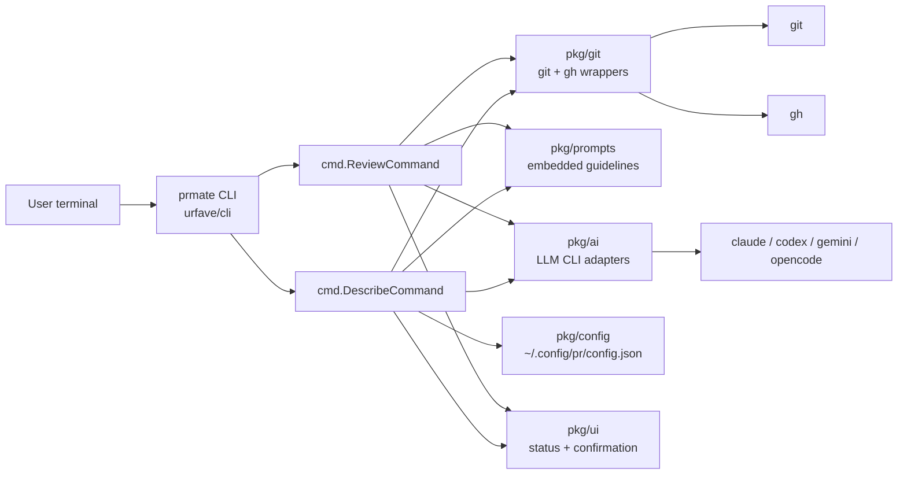
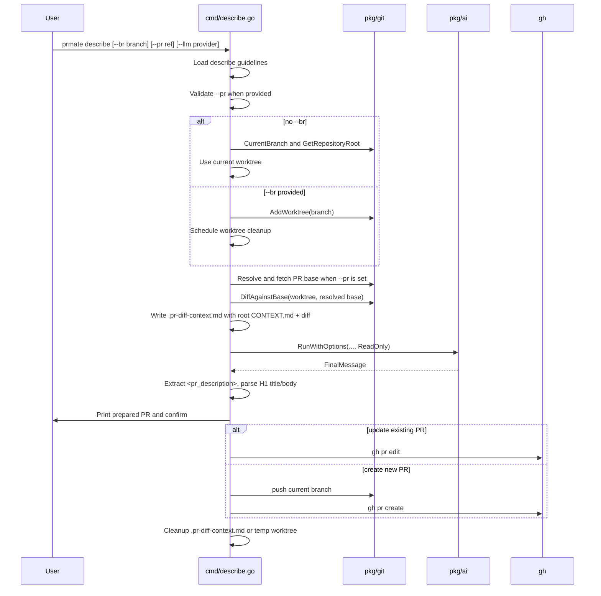
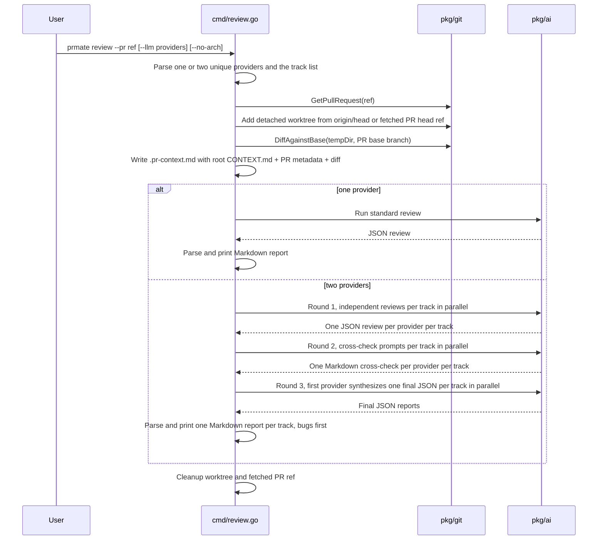

# prmate Context

## Metadata
- Domain: prmate - personal pull request helper CLI
- Primary audience: LLM agents working on this codebase, human contributors
- Status: Active
- Stability note: Sections marked `[STABLE]` should change rarely. Sections marked `[VOLATILE]` are expected to change often.

---

## 0. Context Maintenance Protocol (LLM-First) [STABLE]

This file is the primary working context for the prmate project.

- LLM agents should treat this as a living document and update it whenever meaningful behavior changes.
- If code and this file diverge, prefer updating this file quickly so future work stays reliable.
- Temporary or branch-specific behavior should be documented here with clear cleanup notes.

### Quick update checklist
- Review `Current Work` and `Future Work`.
- Validate `Critical Invariants`.
- Update command, prompt, provider, or config references if behavior changed.
- Remove obsolete notes.

### Freshness target
- Re-review this file regularly, roughly every 2 weeks, to prevent context drift.

---

## 1. Summary [STABLE]

`prmate` is a small Go CLI. It drafts pull request descriptions and runs AI-assisted pull request reviews.

- Primary entry point: [main.go](/home/mat/projects/prmate/main.go)
- CLI framework: `github.com/urfave/cli/v2`
- Go module: `pr`
- Go version: `1.25.4`
- Main commands:
  - `prmate describe`: generate a PR title/body from a branch diff, then create or update a GitHub PR after user confirmation. Accepts `--think`.
  - `prmate review`: review an existing GitHub PR, with either one reviewer or a default two-reviewer cross-check and synthesis flow. With two reviewers it runs two independent tracks, bugs and architecture; `--no-arch` drops the second. Accepts `--think`.
- Supported LLM CLI providers: `claude`, `codex`, `gemini`, `opencode`, each selectable as `<provider>` or `<provider>:<model>`
- External runtime tools: `git`, `gh`, and at least one supported LLM CLI on `PATH`

The codebase is intentionally small and package-oriented. `cmd/` owns user workflows. `pkg/git` wraps `git` and GitHub CLI operations. `pkg/ai` normalizes external LLM CLI calls. `pkg/prompts` embeds the Markdown prompt guidelines. `pkg/ui` owns terminal formatting and confirmation prompts. `pkg/config` reads and writes optional user configuration.

### Where standards live

There are two sources of instruction for every LLM run, and the split is deliberate:

- `pkg/prompts/guidelines/*.md` own **structure and flow only**: what to read and in what order, what is in scope, the steps of each round, and the exact output contract. They carry no opinion about what good code or a good description looks like.
- `GUIDE.md` at the repository root owns **judgment**: what counts as a finding on each review track, what to leave out, what blocks a merge, how a description reads. It is the user's canonical engineering guide, symlinked into each project from a dotfiles repo. Tuning what the bug or architecture track flags is a `GUIDE.md` edit, never a prompt edit.

`GUIDE.md` is required. `requireProjectGuide` reads it from the root of the repository the command was invoked in and returns an error when it is missing or empty, so `prmate describe` and `prmate review` refuse to run rather than silently working to no standard. It is read from the invocation repo, never from a PR worktree: the symlink is gitignored so a worktree copy would be absent, and a checked-in one would let a PR rewrite the standard it is reviewed against.

When adding guidance, ask which of the two it is. Judgment goes in `GUIDE.md`, not in the embedded prompts.

Highest-risk areas:
- External CLI output contracts in `pkg/ai`, especially streamed JSON and JSONL parsing.
- Worktree creation and cleanup around branch and PR review flows.
- Pull request reference parsing and GitHub CLI calls.
- Review JSON extraction and parsing from LLM output.
- Privacy boundaries around diff and PR context files sent to LLM providers.

---

## 2. Repository Layout [STABLE]

```text
.
|-- README.md
|-- CONTEXT.md
|-- go.mod
|-- go.sum
|-- main.go
|-- setup.sh
|-- cmd/
|   |-- describe.go
|   |-- describe_test.go
|   |-- flags.go
|   |-- pr_context.go
|   |-- review.go
|   |-- review_test.go
|   `-- worktree.go
`-- pkg/
    |-- ai/
    |   |-- ai.go
    |   `-- ai_test.go
    |-- config/
    |   `-- config.go
    |-- git/
    |   |-- git.go
    |   `-- git_test.go
    |-- prompts/
    |   |-- prompts.go
    |   |-- prompts_test.go
    |   `-- guidelines/
    |       |-- describe.md
    |       |-- review.md
    |       |-- review-cross-check.md
    |       |-- review-synthesis.md
    |       |-- review-arch.md
    |       |-- review-arch-cross-check.md
    |       `-- review-arch-synthesis.md
    `-- ui/
        |-- ui.go
        `-- ui_test.go
```

Notes:
- There is no long-running server, database, or background service.
- The installed command name is `prmate`, built from the root package.
- Prompt guidelines are embedded with `//go:embed`, so changes under `pkg/prompts/guidelines/` are compiled into the binary.

---

## 3. Architecture [STABLE]

### 3.1 Component map



### 3.2 `prmate describe` flow



Key behavior:
- Current-branch mode writes `.pr-diff-context.md` into the repo root and removes it on cleanup.
- Explicit branch mode creates a temporary git worktree and removes it on cleanup.
- `.pr-diff-context.md` embeds root `GUIDE.md`, then root `CONTEXT.md` when present, then the branch diff, and instructs the LLM to read the guide first and follow relevant domain-context pointers.
- With `--pr`, describe reads the PR base branch from GitHub and fetches it before diffing local HEAD against `origin/<base>` using the merge base. Metadata/fetch failures stop the command. The selected base is shown in progress output and used in the context file and prompt.
- Without `--pr`, describe continues to use `origin/main`.
- `DiffAgainstBase` never falls back to main when an explicit base cannot be resolved; this applies to both describe and review.
- The LLM must wrap final Markdown in `<pr_description>` tags. A fallback trims known Claude Code watermark lines and uses the raw message.
- The first Markdown H1 becomes the PR title. Remaining Markdown becomes the PR body.
- Creating or updating a PR is gated by an interactive `ui.Confirm` prompt.

### 3.3 `prmate review` flow



Key behavior:
- `--pr` accepts a number or URL containing `/pull/<number>`.
- Default reviewers are `defaultReviewLLMs` from `cmd/flags.go`, currently `codex:gpt-6-astra,claude:claude-opus-5-5`. `prmate describe` defaults to `defaultDescribeLLM`, currently `claude:claude-opus-5-5`, pinned in the same file.
- `reviewTrack` is a closed enum: `trackBugs` and `trackArchitecture`. The paired flow runs the track list through every round, and the tracks never meet inside an LLM call: round 1 and round 2 prompts are built per track, round 3 synthesizes per track, and the reports are concatenated in Go. Default is both tracks; `--no-arch` is bugs only.
- The single-reviewer flow is bugs only. The architecture track exists to be cross-checked, so with one reviewer it is skipped with a note rather than run unverified.
- Each `--llm` entry is an `ai.Spec`: `<provider>` or `<provider>:<model>`. `ai.ParseSpec` validates the provider against the closed set and requires a non-empty model after `:`. The model itself is passed through to the provider CLI unvalidated, since model names are external data.
- At most two reviewers are supported. Duplicates are removed on the full spec string while preserving first-seen order, so `claude:opus,claude:sonnet` is two reviewers but `claude,claude` is one.
- Reviewers are labelled by `Spec.String()` everywhere a name is user- or LLM-visible: progress lines, spinner statuses, failure notes, and the `provider="..."` attributes in cross-check and synthesis prompts. This is what keeps two models of one provider distinguishable to the synthesizer.
- Review worktrees are detached.
- `addWorktreeFromPullRequestHead` first tries `origin/<headRefName>`, then falls back to fetching `pull/<number>/head` into `refs/pr-tool/pr/<number>`.
- `.pr-context.md` contains the project guide, project context, PR metadata, title, body, and local diff against the PR base branch. Review prompts instruct the LLM to read the guide first, then follow relevant domain-context pointers before reviewing, cross-checking, or synthesizing.
- For PR review, project context is read from `CONTEXT.md` on the PR base ref when possible (`origin/<base>` then `<base>`), then falls back to the checked-out worktree. This avoids treating contributor changes to root context as authoritative reviewer instructions.
- Bug track output must parse to `ReviewReport` JSON, which carries a verdict and severities. Architecture track output must parse to `ArchReport` JSON, which has no verdict: each finding carries `cost` (`high`, `medium`, `low`, a closed set rejected on parse), `location`, `diverges_from`, `description`, `suggestion`. Findings render highest cost first. The CLI tolerates fenced JSON and extracts a balanced top-level object when possible. Round 1 responses are parsed before the cross-check so a malformed review fails early.

### 3.4 LLM provider adapter contracts

`pkg/ai` builds provider-specific commands and normalizes each provider into:

```go
type Response struct {
    Provider     string
    FinalMessage string
    RawTransport string
}
```

`pkg/ai` takes an `ai.Spec{Provider, Model}` rather than a bare provider string. `Model` is empty unless the user asked for one, and every provider branch appends `--model <model>` only when it is set, so the default-model behavior is unchanged when no model is given.

Provider command expectations:
- Claude: `claude -p --output-format json` or `stream-json` in verbose mode, plus `--model <model>` when the spec names one.
- Gemini: `gemini -p <prompt> --output-format json` or `stream-json` in verbose mode, plus `--model <model>` when the spec names one.
- Codex: `codex exec --color never --output-last-message <tempfile> <prompt>`, with `--json` in verbose mode, plus `--model <model>` when the spec names one.
- OpenCode: `opencode run --format json <prompt>`, plus `--model <model>` when the spec names one (OpenCode expects `provider/model`).

Thinking/reasoning effort mapping (validated per provider, independent of the model override):
- User-facing flag: `--think <level>` (alias `--thinking`) on `prmate describe` and `prmate review`. Default is `high`.
- Codex: reasoning effort is passed as `-c model_reasoning_effort="<level>"`; accepted levels are `none`, `minimal`, `low`, `medium`, `high`, `xhigh`.
- Claude: reasoning effort is passed as `--effort <level>`; accepted levels are `low`, `medium`, `high`, `xhigh`, `max`.
- OpenCode: passed through as `--variant <level>` because OpenCode variants are provider/model-specific and may be custom.
- Gemini: unsupported by current Gemini CLI adapter. The implicit default is ignored for Gemini, but explicitly setting `--think` with Gemini returns a clear error.

Modes:
- `ReadOnly` is labeled `READ` and is used by current `describe` and `review` flows.
- `Write` exists for provider permission flags, but current command workflows do not use it.

Streaming mode displays tool-use activity to stderr while collecting the final assistant message. Non-streaming mode parses the provider's final JSON or JSONL output after process exit.

---

## 4. Data and File Contracts [STABLE]

### 4.1 User config

Optional config path:

```text
~/.config/pr/config.json
```

Supported schema:

```json
{
  "github_reviewers": "github-handle-1,github-handle-2"
}
```

`github_reviewers` is only used by `prmate describe` when creating a new PR. The config directory is created with `0755`, and the file is written with `0600`.

### 4.2 Temporary context files

The CLI writes temporary Markdown context files for LLMs:

- `.pr-diff-context.md` for `prmate describe`
- `.pr-context.md` for `prmate review`

These files contain root project context, code diffs, and PR metadata. They must be treated as transient and sensitive.

Important cleanup behavior:
- Current-branch describe mode removes `.pr-diff-context.md` from the repo root.
- Branch describe mode removes the temporary worktree.
- Review mode removes the temporary worktree and deletes fetched `refs/pr-tool/pr/<number>` refs when used.

### 4.3 Privacy

This tool passes PR title, PR body, local diff content, and selected worktree files to external LLM CLIs. Do not use it on code that cannot be sent to the selected provider.

---

## 5. Critical Invariants [STABLE]

- Keep the installed binary command name as `prmate` unless install docs and setup behavior are updated together.
- The root `prmate` command only prints help. There are exactly two workflows, `describe` and `review`, both invoked explicitly; do not add a dispatcher that guesses which one the user meant.
- Model and reasoning defaults live only in `cmd/flags.go`, and every default spec names its model. Never reintroduce a bare provider default: it would silently follow the machine's CLI config or account default.
- `cmd/` should own top-level user workflows and orchestration. Keep external command execution details in `pkg/git` or `pkg/ai`.
- `prmate describe` and `prmate review` should continue running LLMs in `ai.ReadOnly` mode unless a command is explicitly designed to modify code.
- Do not skip the interactive confirmation before creating or updating a PR.
- Preserve worktree cleanup paths. Any new early return after worktree creation must still cleanup through `defer`.
- Preserve `0600` permissions for context/config files containing PR or diff content.
- Generated LLM context files should include root `CONTEXT.md` when present. PR review should prefer the base-ref version of `CONTEXT.md` over the PR-head version.
- `GUIDE.md` stays required and stays read from the invocation repository root. Do not add a silent fallback, a default guide, or a worktree read path; a run with no guide must fail loudly.
- Embedded prompt guidelines stay structure and flow only. Any rule about what makes a finding or a description good belongs in `GUIDE.md`.
- `ReviewReport` and `ArchReport` JSON shapes are public internal contracts between prompts and parser. Update prompt guidelines, parser, tests, and Markdown rendering together.
- `ArchReport` has no verdict field. The architecture track never gates a merge, and the shape must stay unable to express one. `cost` ranks findings for the reader; it is not a gate.
- Keep prompt guidelines embedded through `pkg/prompts`; do not replace them with runtime file reads unless install and packaging behavior are redesigned.
- Do not broaden LLM provider names in command parsing without adding provider adapter behavior and tests. Provider names stay a closed set in `ai.ParseSpec`; model names stay pass-through.
- Anything that names a reviewer to the user or to another LLM uses `Spec.String()`, never `Spec.Provider`. Two reviewers on one provider are only distinguishable by the full spec.
- Do not add new thinking levels for Codex or Claude without checking provider docs/help and updating validation tests.
- Bug track prompts constrain agents to changed files and directly referenced code, with no repository search. Architecture track prompts widen that to the touched domain, one sibling domain, and targeted search for duplication the diff extends. Neither track tours the repository.

---

## 6. Testing Strategy [STABLE]

Test command:

```bash
go test ./...
```

Current package coverage:
- `cmd`: prompt construction, reviewer spec list parsing (including two models of one provider), JSON extraction, track list selection, guideline loading per track, architecture report rendering, and invalid PR validation.
- `pkg/ai`: provider command construction, response parsing, mode labels, and output normalization.
- `pkg/ai` thinking controls: provider-specific command arguments and unsupported-provider validation.
- `pkg/ai` spec parsing: provider/model splitting, label formatting, and rejection of unknown providers or empty models.
- `pkg/git`: PR reference parsing/list parsing, git diff helpers, branch/change detection, push behavior, PR ref fetch/delete helpers.
- `pkg/prompts`: embedded guideline loading.
- `pkg/ui`: color/no-color formatting.

Testing guidance:
- Keep tests close to package behavior.
- Prefer pure unit tests for parsing, prompt construction, formatting, and provider command construction.
- Use temporary git repositories for `pkg/git` behavior that must exercise real git commands.
- Avoid tests that require authenticated `gh` or real LLM CLI network access unless they are explicitly integration/manual checks.
- For new external CLI provider behavior, test command argv construction and response parsing with fixture strings.
- For changes to worktree lifecycle, add tests around helper functions where possible before reaching for end-to-end CLI tests.

---

## 7. Development Workflow [STABLE]

Install locally:

```bash
./setup.sh
```

Run from source:

```bash
go run . --help
```

Run tests:

```bash
go test ./...
```

Build manually:

```bash
go build -o prmate .
```

Format Go code before handoff:

```bash
gofmt -w <changed-go-files>
```

Setup behavior:
- `setup.sh` requires `git`.
- If `go` is missing, it installs Go `1.25.4` under `~/.local/go`.
- If `gh` is missing, it installs GitHub CLI `2.88.1` into `INSTALL_DIR`, defaulting to `~/.local/bin`.
- It builds the root package and installs `prmate` into `INSTALL_DIR`.
- It warns if `gh` is not authenticated or `INSTALL_DIR` is not on `PATH`.

---

## 8. Known Caveats [VOLATILE]

- Provider CLIs are external and their JSON/JSONL output formats may change. `pkg/ai` is the compatibility boundary.
- Provider thinking flags are not uniform: Codex and Claude leave model selection to their CLI defaults, Codex uses a config override for effort, Claude uses `--effort`, OpenCode uses variants, and Gemini currently has no supported mapping. The CLI defaults to `high` for supported providers and ignores that implicit default for Gemini.
- `prmate describe` without `--pr` still uses `origin/main`; it does not infer a stacked parent or the repository default branch.
- `git.FetchOrigin` calls are best effort in some worktree creation paths. This is intentional for local-only branches, but it means stale remotes can affect generated diffs.
- `BranchExists` runs git in the current process directory rather than accepting an explicit repo path.
- Every `prmate describe` and `prmate review` run now requires `GUIDE.md` at the invocation repository root. A project without the symlink cannot use the tool until one is added.
- `Write` mode exists in `pkg/ai`, but user-facing workflows currently use read-only LLM runs.
- Tests do not cover live `gh pr create/edit/view`, authenticated GitHub behavior, or real LLM CLI execution.

---

## 9. Current Work [VOLATILE]

- Architecture review track: two more reviewer runs per round with a pure maintainability focus, judged against the architecture review section of `GUIDE.md`.

---

## 10. Future Work [VOLATILE]

Potential improvements worth considering:
- Support repository default base branch detection instead of hardcoded `origin/main` in `prmate describe` without `--pr`.
- Consider a `prmate doctor` check that reports a missing `GUIDE.md` before a run rather than at run time.
- Add explicit tests for OpenCode parsing and verbose streaming edge cases.
- Add a non-interactive or dry-run mode if automation use cases become important.
- Add integration smoke tests behind opt-in environment flags for `gh` and provider CLIs.
